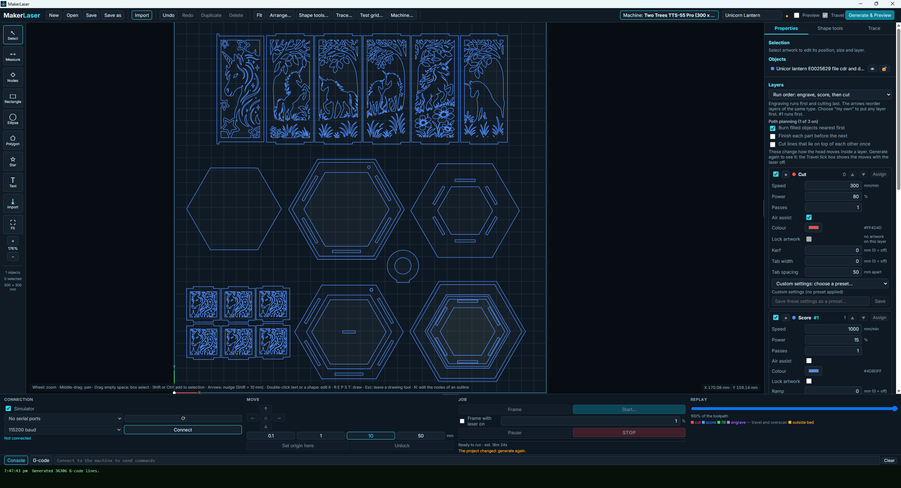

# MakerLaser

**Free, open-source laser CAD/CAM software for designing, preparing and running laser cutting and engraving jobs.**

[Website](https://wackojacko78.github.io/MakerLaser/) | [Download](https://github.com/Wackojacko78/MakerLaser/releases) | [Report an issue](https://github.com/Wackojacko78/MakerLaser/issues)



MakerLaser is built for hobbyists, makers and small businesses who want a straightforward path from **design’ job preparation’ laser**. It targets the **Two Trees TTS-55 Pro** first and **GRBL 1.1** machines more broadly, with an architecture that leaves room for additional controller families later.

> **Status: pre-release.** MakerLaser is under active development. It has generated and run real jobs on a Two Trees TTS-55 Pro, but some newer features still need broader real-machine testing. Read [VERIFICATION.md](VERIFICATION.md) for the current verification status and [SAFETY.md](SAFETY.md) before the first powered job.

## Why MakerLaser?

- **Free and open source:** GPL-3.0-or-later, with no subscription.
- **Direct design workflow:** draw and edit on the canvas with exact dimensions rather than bouncing through modal dialogs.
- **Practical laser CAM:** layers, kerf compensation, cut tabs, shared-line removal, path optimisation, overscan and job preview.
- **Image workflows:** bitmap tracing plus dithered, grayscale and quantized-power photo engraving.
- **Real machine control:** connect to GRBL, jog, frame, set origin, stream jobs, pause, resume and stop.
- **Test without hardware:** the built-in simulator supports the same job workflow without connecting a laser.

## What it does

A typical MakerLaser workflow is:

1. **Import or draw** an SVG, DXF, PNG, JPG or BMP, or create shapes and text directly on the canvas.
2. **Edit precisely** using numeric position and size, snapping, node editing and shape tools.
3. **Assign operations** using Cut, Score, Fill and Image layers.
4. **Prepare the job** with speed, power, passes, kerf, cut tabs, raster settings and material presets.
5. **Generate & Preview** the colour-coded toolpath, cut order, runtime estimate and safety checks.
6. **Connect and frame** the job on the machine.
7. **Run** the checked job with pause, resume and STOP controls available during streaming.

New here? Start with the [user guide](docs/user-guide.md). The complete documentation index is in [docs/README.md](docs/README.md).

## Features

| Area | Capabilities |
|---|---|
| **Workspace** | Pan/zoom canvas, grid, machine bed, origin marker, box and multi-select, move/resize/rotate, duplicate, delete, undo/redo, numeric position and size, native drag-and-drop, resizable panels |
| **Drawing** | Rectangle, ellipse, polygon, star and text created directly on the canvas with exact numeric sizing and editing afterwards; 35 built-in fonts plus installed system fonts |
| **Node editing** | Node selection and movement, add/delete nodes, Bézier handles and node types, curve fitting and snapping |
| **Import** | SVG including path commands, transforms, units, `<use>` and `<symbol>`; DXF including LINE, ARC, CIRCLE, ELLIPSE, LWPOLYLINE with bulges, POLYLINE, SPLINE, INSERT blocks and arrays; PNG/JPG/JPEG/BMP |
| **Measure** | Snap to corners, midpoints, centres and edges; distances, angles, gaps; selection size and outline length |
| **Geometry** | Boolean union/difference/intersection/XOR, offsets, fillets and chamfers, arrays, kerf compensation |
| **Trace** | Bitmap tracing with Logo, Photo and Detailed presets, brightness, contrast, gamma, local-detail recovery, adaptive thresholding, speck removal and simplification |
| **Raster / photos** | Brightness, contrast, gamma, invert, sharpening; Floyd-Steinberg, Jarvis, Stucki and Atkinson dithering; grayscale and quantized-power engraving; adjustable minimum power, white cutoff and tonal levels; live preview; rotated and mirrored images |
| **CAM** | Nesting-aware cut order, holes before outer boundaries, travel reduction, part-by-part planning, optional shared/overlapping cut removal, cut tabs, custom run order, whole-job passes, serpentine fill, bidirectional raster, overscan, fill outline pass, score-line power ramps, material test grid and auto-arrange |
| **G-code** | GRBL 1.1 with M4 dynamic power, variable-power raster output, laser-off travel, air assist M8/M9 and modal-state tracking |
| **Placement** | Absolute, Current position or User origin, job-origin points and Frame to check where the job will land |
| **Machine** | USB serial GRBL with character-counting streaming, pause/resume/stop on the real-time channel, jog, home, unlock, set origin, low-power framing, command box for `$$` and settings, state checks and alarm/error decoding |
| **Preview** | Colour-coded moves, power-aware raster preview, cut-order numbers, replay slider, out-of-bed highlighting and optional laser-off travel |
| **Safety** | Bed-bounds, layer and NaN checks, stale-preview lock, pre-flight confirmation, one job at a time and connection required for machine motion |
| **Project** | `.mlp` ZIP archive, atomic saves, shared image assets and schema versioning |
| **Machines & materials** | Catalogue of 19 machine profiles and 31 starter material presets; create, edit, import and export your own |

## Quick start on Windows

One-time prerequisites are described fully in [INSTALL.md](INSTALL.md).

```powershell
winget install OpenJS.NodeJS.LTS Rustlang.Rustup Microsoft.VisualStudio.2022.BuildTools
cd C:\Dev\MakerLaser
npm install
.\verify-makerlaser.ps1
npm run dev
.\build-windows.ps1
```

`verify-makerlaser.ps1` compiles and tests the project and writes `verification.log`. `npm run dev` launches the desktop application from the repository. `build-windows.ps1` builds the Windows installers.

For macOS/Linux notes and troubleshooting, see [INSTALL.md](INSTALL.md) and [docs/linux.md](docs/linux.md).

## Architecture

```text
React UI (Konva canvas, Zustand state)                 apps/desktop-ui
        ”‚
        ”‚ Tauri commands
        –¼
Application services                                  apps/rust-core
        ”‚
        –¼
Domain models †’ Operations †’ Toolpaths †’ G-code       packages/common, packages/project
        –²                                      ”‚
        ”‚                                      –¼
Geometry / import          Raster                Machine layer
packages/geometry          packages/raster      packages/machine
                                                    ”‚
                                                    –¼
                                                Hardware
```

The UI does not build G-code directly. See [docs/architecture.md](docs/architecture.md) for details.

## Repository layout

```text
apps/desktop-ui     React + TypeScript + Konva + Zustand
apps/rust-core      Tauri shell and commands
packages/common     Domain models and serialization
packages/geometry   Geometry, SVG/DXF import and path operations
packages/raster     Image adjustment, dithering and resampling
packages/machine    GRBL controller, simulator, status and error decoding
packages/project    CAM planner, toolpaths, G-code, safety and .mlp format
docs/               Website, user guide, architecture and project documentation
tests/fixtures      SVG and DXF integration-test samples
scripts/            Verification, build and documentation checks
```

## Tests

```text
cargo test --workspace       Rust unit + integration tests
npm run ui:test              Front-end unit and state tests
npm run verify               Rust + UI tests, type-check, lint and production build
node scripts/check-docs.mjs  Documentation consistency checks
```

MakerLaser's tests cover geometry, CAM, G-code, GRBL protocol against a fake controller, project-file handling, UI state and editing workflows.

## Testing and feedback

MakerLaser is still pre-release software, so real-world testing is especially useful.

If you try it, please include the following in bug reports where relevant:

- MakerLaser version or commit
- laser make/model
- controller/firmware, such as GRBL or FluidNC
- connection type
- what you expected
- what happened
- screenshots, G-code or a sample project when possible

[Report a MakerLaser issue](https://github.com/Wackojacko78/MakerLaser/issues)

## Licence

MakerLaser is licensed under **GPL-3.0-or-later**. See [LICENSE](LICENSE).

No code from LaserGRBL or any other GPL project is included; see [THIRD_PARTY_NOTICES.md](THIRD_PARTY_NOTICES.md).

---

**[MakerLaser website](https://wackojacko78.github.io/MakerLaser/) | [Download](https://github.com/Wackojacko78/MakerLaser/releases) | [GitHub](https://github.com/Wackojacko78/MakerLaser)**
